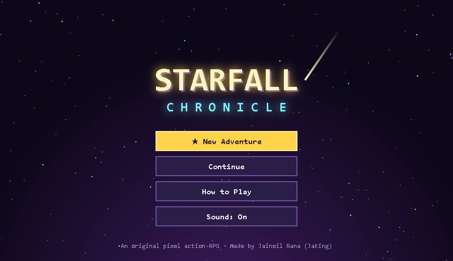
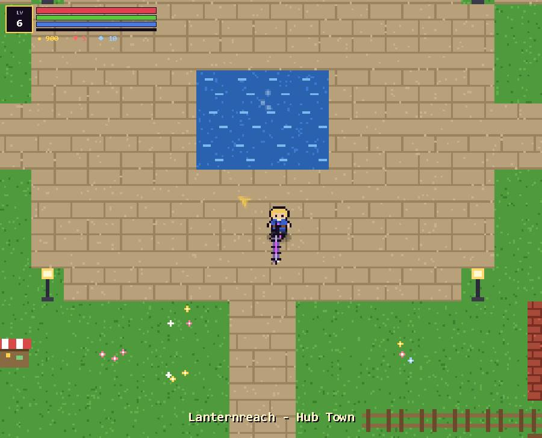
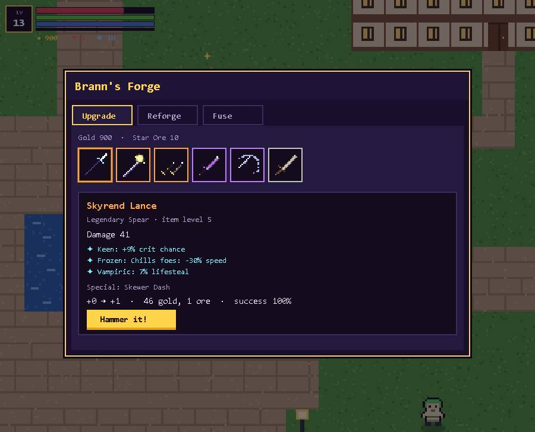
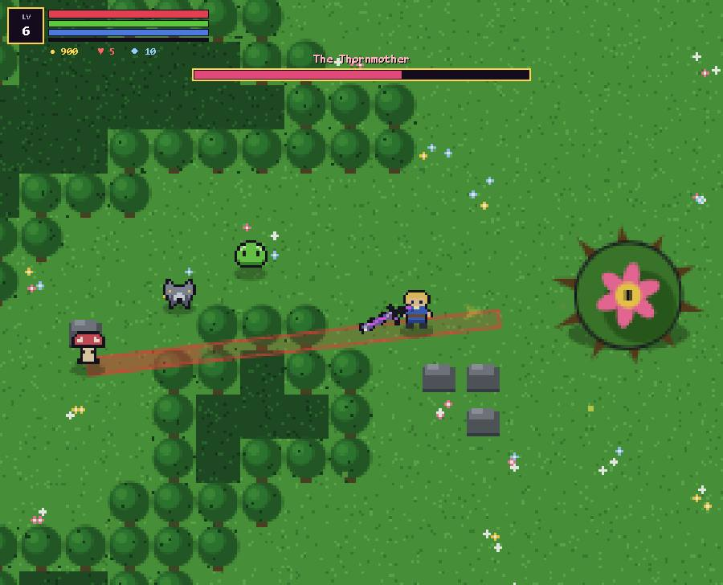
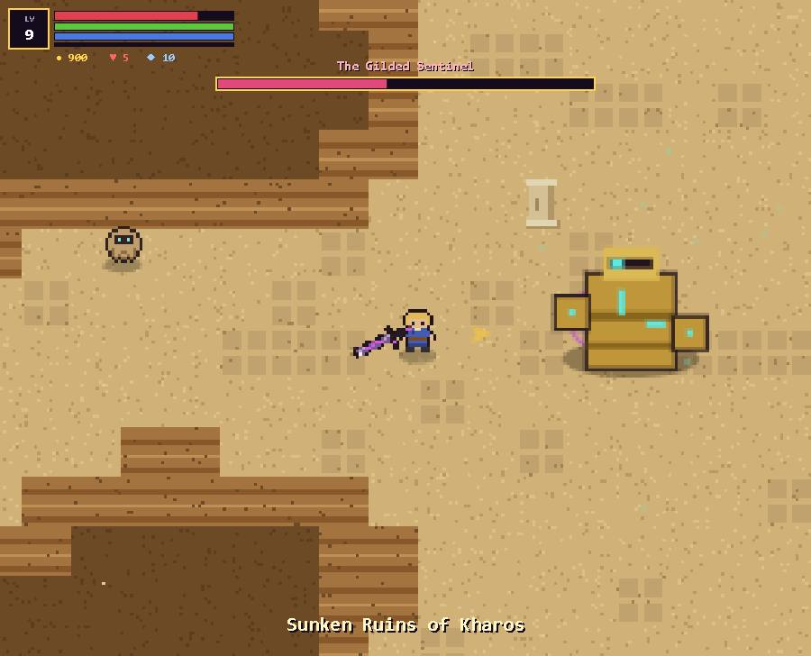
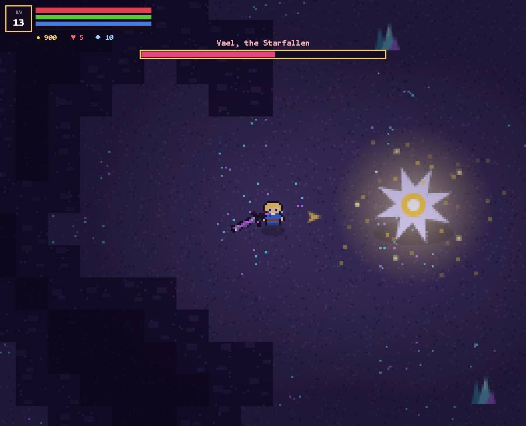
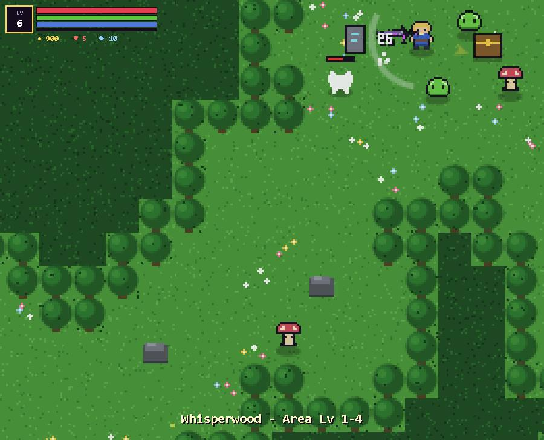

<div align="center">

# ⭐ Starfall Chronicle

**An original top-down pixel-art action RPG. Swing, roll, loot and forge your way through three acts to recover the fallen Star Shards.**

[](https://jaigod.github.io/starfall-chronicle/)
[](https://github.com/JaiGod/starfall-chronicle/releases/latest)
[](LICENSE)


</div>

---

## 📸 Screenshots

| Title screen | Lanternreach (town hub) |
|:---:|:---:|
|  |  |
| **Brann's Forge (blacksmith)** | **Boss: The Thornmother** |
|  |  |
| **Sunken Ruins of Kharos** | **Final boss: Vael, the Starfallen** |
|  |  |

<p align="center"><b>Whisperwood combat</b><br></p>

On phones the game switches to a virtual joystick plus ATK / ROLL / SKILL / USE / POT buttons, and it fits a 390 px screen with no sideways scrolling.

## ✨ Features

- **5 weapon classes**, each with its own combo chain and charged special:
  Sword (*Whirlwind*), Spear (*Skewer Dash*), Bow (*Star Volley*), Staff (*Nova*), Twin Daggers (*Shadowstep*).
- **35 hand-designed weapons** across **5 rarities** (Common → Uncommon → Rare → Epic → Legendary), drawn in code.
- **Random affixes**: Burning, Frozen, Vampiric, Keen, Swift and Mighty. Legendary crits trigger a starburst.
- **Brann's Forge**: upgrade weapons from +1 to +10 (gold + Star Ore, with a success chance), reforge affixes and fuse duplicates.
- **3 multi-phase bosses** with telegraphed attacks: The Thornmother, The Gilded Sentinel and Vael, the Starfallen.
- **4 areas**: the town of Lanternreach, Whisperwood, the Sunken Ruins of Kharos and the Prism Deep.
- **Quests**: a 3-act main story with a choice of ending, plus side quests (Glowcaps, Dune Raiders, Echoes in the Deep).
- **RPG progression**: levels, stat points (STR/VIT/AGI/INT), a skill tree, active skills, armor and trinkets, and a shop.
- **3 save slots** with autosave on area change and a healing fountain save point (localStorage, safely wrapped).
- **Juice**: hit-stop, screen shake, particles, damage numbers, slow-mo boss kills and a procedural WebAudio chiptune soundtrack.
- **Works everywhere**: keyboard and mouse on desktop, virtual joystick and buttons on phones, and an Android APK.

## 🎮 Controls

| Action | Keyboard / mouse | Touch |
|---|---|---|
| Move | WASD / arrow keys | Left-side joystick |
| Attack / combo | Left click / J (hold and release for the special) | Attack button (auto-aim) |
| Dodge-roll | Space / Shift | Roll button |
| Cast skill | Right click / K | Skill button |
| Potion | F / 1 | Potion button |
| Talk / interact | E | Interact button |
| Inventory, Character, Quests | I, C, L | Menu button |
| Pause / mute | Esc / M | Menu |

**Tip:** red zones are telegraphed enemy attacks, so roll through them. Follow the gold arrow to your next objective.

## 🛠 Tech stack

- **Vanilla JavaScript + HTML5 Canvas**: no engine, no frameworks, no runtime requests.
- **All art is code**: pixel sprites, tiles, weapon icons and bosses are drawn procedurally in [`data.js`](data.js).
- **WebAudio** synth for music and sound effects.
- **Capacitor 6 + Gradle** in [GitHub Actions](.github/workflows/android.yml) to build the Android APK.
- **GitHub Pages** hosts the web version straight from `main`.

## 📁 Project structure

```
starfall-chronicle/
├── index.html                  # Page shell, UI panels (inventory, forge, shop, quests), touch controls
├── game.js                     # Engine: loop, player, combat, AI, bosses, areas, saves
├── data.js                     # Content and art: weapons, affixes, enemies, bosses, quests, dialogue, sprites, music
├── docs/screenshots/           # README screenshots
├── .github/workflows/android.yml  # Builds the APK and publishes release v1.0.0
└── LICENSE
```

Browse the source: [`index.html`](index.html) · [`game.js`](game.js) · [`data.js`](data.js) · [`workflow`](.github/workflows/android.yml)

## 🚀 Run locally

```bash
git clone https://github.com/JaiGod/starfall-chronicle.git
cd starfall-chronicle
python3 -m http.server 8000
# open http://localhost:8000
```

Or just open `index.html` in a browser. To get the Android build, run the **Build Android APK** workflow (or push to `main`) and grab `StarfallChronicle.apk` from [Releases](https://github.com/JaiGod/starfall-chronicle/releases).

## 📓 Development log

- **Design goal.** I wanted a loot-driven action RPG that feels good in the first 30 seconds: snappy attacks, a dodge-roll with i-frames, and enemies that clearly telegraph what they are about to do.
- **Weapons as data.** Every weapon is one row: `[name, class, rarity, damage mod, blade, hilt, accent, fixed affix]`. The same row drives stats, the tooltip and the procedurally drawn icon, so adding a weapon is a single line.
- **Five classes, five feels.** Each class has its own reach, arc, attack speed and combo multipliers. The daggers' 4-hit chain and high crit play nothing like the spear's long, narrow poke.
- **Telegraphs over twitch.** Boss attacks (lines, rings, slams, summons) first draw a red warning zone that fills up, then fire. This made the fights fair on phones too, where precise aim is harder.
- **Boss phases.** Each boss switches to a faster, nastier attack pattern partway through its health bar (Vael has three phases), with a banner message so the player knows.
- **Forge economy.** Upgrades cost gold and Star Ore, and success chances drop at higher levels. Reforge rerolls affixes, and Fuse turns duplicates into progress, so low-rarity drops still have value.
- **Mobile.** Touch input uses a floating joystick on the left and buttons on the right, and attacks auto-aim at the nearest enemy. Verified at 390x844 with no horizontal scroll.
- **Challenge: invincibility frames.** During testing, rapid hits on bosses seemed to do nothing. The cause was the per-hit `inv` window working as intended, so I kept it and tuned boss HP around it.
- **Challenge: saves.** All `localStorage` access is wrapped in try/catch, so private windows still play fine, just without saving.
- **Testing.** Automated Playwright runs start a new game, enter every area, spawn and fight all three bosses to their deaths, open the forge, and save, with zero console errors on desktop and mobile viewports.
- **Screenshots.** All README screenshots were captured straight from the canvas of the live GitHub Pages build.
- **Beta tested on the live site ✅ (2026-11-05).** On https://jaigod.github.io/starfall-chronicle/ I started a new adventure from the title menu, talked to Elder Oren, entered Whisperwood and fought with keyboard input (moving, combos, dodge-rolls, potions) for over a minute. Enemies died, loot and XP dropped, the canvas rendered and the console stayed free of errors.

## 📜 License

[MIT](LICENSE) © 2026 Jaineil Rana

## 🔗 More from JaiGod

- 🏰 [The JaiGod organization](https://github.com/JaiGod): all my games
- [Ember Crypt](https://github.com/JaiGod/ember-crypt) · [The Hollow Between](https://github.com/JaiGod/the-hollow-between) · [Isle of Embers](https://github.com/JaiGod/isle-of-embers) · [Harvest Hollow](https://github.com/JaiGod/harvest-hollow)

---

<p align="center">Made by Jaineil Rana (JaKing) · part of <a href="https://github.com/JaiGod">JaiGod</a></p>
